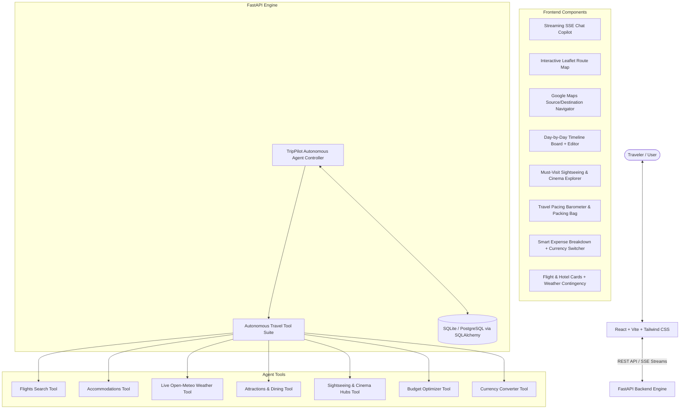

# ✈️ TripPilot Agent - Autonomous AI Travel Planner & Copilot

[](https://github.com/UNNI-gif/trippilot-agent/actions)
[](https://fastapi.tiangolo.com)
[](https://www.python.org/)
[](https://react.dev/)
[](https://vitejs.dev/)
[](https://tailwindcss.com/)
[](LICENSE)
[](https://ai.google.dev/)

**TripPilot Agent** is an enterprise-grade, full-stack AI travel planning copilot and autonomous itinerary synthesis engine. Powered by **Google Gemini**, **FastAPI**, **SQLAlchemy**, and **React (Vite + Tailwind CSS)**, it transforms natural language travel prompts into detailed, realistic, day-by-day itineraries with live maps, navigation, real-time meteorological forecasts, localized currency budgeting, and boutique accommodations.

---

## 🌟 Key Features

- 🤖 **Autonomous AI Travel Copilot**: Context-aware planning agent backed by Google Gemini with autonomous multi-tool calling (`search_flights`, `search_hotels`, `weather_forecast`, `budget_optimizer`, `sightseeing_hubs`).
- ⚡ **Real-Time SSE Streaming**: Word-by-word streaming responses with live thought indicators and animated execution badges as the agent performs background research.
- 🗺️ **Interactive Route Map (Leaflet & OpenStreetMap)**: Authentic GPS coordinates, day-by-day color-coded pins, route trail polylines, schedule popups, and day filters.
- 🧭 **Google Maps Source & Destination Navigation**: One-click external directions connecting starting points directly to destinations, including real-time distance calculations and transit advisories.
- 🎬 **Must-Visit Sightseeing & Cinematic Hubs**: Curated directory of iconic global sights and famous Indian cinema locations across North, South, East, and West India with direct GPS mapping.
- ⛅ **Live Meteorological Weather (Open-Meteo API)**: Real-time temperature, precipitation probability, weather codes, and automatic **Rainy Day Contingency Pivot** recommendations.
- ⚖️ **Travel Pacing Barometer**: Real-time itinerary pacing analysis (Relaxed, Balanced, Packed) with fatigue mitigation tips.
- 🧳 **Interactive Packing Bag**: Contextual packing checklist dynamically synthesized based on destination climate, terrain, and trip duration.
- 💱 **Multi-Currency Live Converter & Localization**: Automatic destination currency standardizer (USD `$`, EUR `€`, GBP `£`, JPY `¥`, INR `₹`, CAD `$`, AUD `$`) with live exchange rates.
- ✏️ **Inline Activity Customizer & Editor**: Modal editor to customize times, descriptions, costs, delete activities, or append new activities to any day on the fly.
- 🛫 **Flight & Hotel Recommendations**: Live route visualizations, flight schedules, pricing estimates, and hotel tiers (Luxury, Boutique, Mid-Range, Budget).
- 💰 **Comprehensive Budget Breakdown**: Category-by-category expense forecasts (transit, lodging, dining, tickets, emergency buffer).
- 💾 **Session & Trip Persistence**: SQLite and PostgreSQL support with full CRUD, history, and message memory.
- 📤 **Multi-Format Export**: Export any trip plan to JSON, clean Markdown (for Notion/Obsidian), or print-ready PDF.
- 🐳 **Production Dockerized**: Multi-stage Nginx frontend build and slim Python backend orchestrated via Docker Compose.
- 🔄 **Automated CI/CD**: GitHub Actions workflow (`.github/workflows/ci.yml`) validating tests and Docker images on push.

---

## 🏗️ Architecture



---

## 📂 Repository Structure

```
TripPilot Agent/
├── .github/
│   └── workflows/
│       └── ci.yml               # GitHub Actions CI/CD Pipeline
├── backend/
│   ├── app/
│   │   ├── agents/
│   │   │   └── trip_agent.py    # Autonomous Gemini Travel Copilot
│   │   ├── api/
│   │   │   └── routes/          # Chat, trips, weather, currency endpoints
│   │   ├── core/                # App configuration, logging, settings
│   │   ├── db/                  # SQLAlchemy models and session lifecycle
│   │   ├── services/            # Trip generation & external API clients
│   │   ├── tools/               # Agent tool implementations
│   │   └── main.py              # FastAPI application entry point
│   ├── tests/
│   │   └── test_api.py          # Pytest backend test suite (12 tests)
│   ├── .dockerignore
│   ├── .env.example             # Backend environment template
│   ├── Dockerfile               # Backend Dockerfile
│   ├── pytest.ini               # Pytest configuration
│   └── requirements.txt         # Python dependencies
├── frontend/
│   ├── public/
│   ├── src/
│   │   ├── components/          # MapView, ChatCopilot, ItineraryView, etc.
│   │   ├── services/            # Axios API & SSE streaming clients
│   │   ├── App.jsx              # Main UI controller
│   │   ├── index.css            # Tailwind CSS styling
│   │   └── main.jsx             # React entry point
│   ├── .dockerignore
│   ├── Dockerfile               # Frontend multi-stage Nginx Dockerfile
│   ├── nginx.conf               # Production Nginx reverse-proxy configuration
│   ├── package.json             # Frontend dependencies
│   ├── tailwind.config.js       # Tailwind configuration
│   └── vite.config.js           # Vite build configuration
├── .env.example                 # Root environment template
├── .gitignore                   # Git ignore rules for Python, Node, DBs
├── docker-compose.yml           # Multi-container orchestration
├── LICENSE                      # MIT Open Source License
├── README.md                    # Comprehensive documentation
└── run_dev.ps1                  # One-click Windows PowerShell dev launcher
```

---

## 🚀 Quick Start (Local Development)

### Prerequisites
- **Python 3.11+** (Python 3.11, 3.12, and 3.13 supported)
- **Node.js 18+** & **npm**
- **Google Gemini API Key** (optional: high-fidelity synthetic fallback active when key is unset)

---

### Method A: One-Click Launcher (Windows)

Run the included PowerShell launcher from the project root:

```powershell
.\run_dev.ps1
```

This will automatically configure virtual environments, install dependencies, and launch both backend and frontend servers.

---

### Method B: Manual Step-by-Step Setup

#### 1. Clone the Repository
```bash
git clone https://github.com/UNNI-gif/trippilot-agent.git
cd trippilot-agent
```

#### 2. Backend Setup
```bash
cd backend

# Create virtual environment
python -m venv venv

# Activate virtual environment
# On Windows PowerShell:
.\venv\Scripts\activate
# On Linux / macOS:
source venv/bin/activate

# Install dependencies
pip install -r requirements.txt

# Configure environment variables
cp .env.example .env

# Run automated tests to verify setup
python -m pytest -v

# Start FastAPI development server
uvicorn app.main:app --reload --port 8000
```
Backend API will be running at [http://localhost:8000](http://localhost:8000). Interactive Swagger docs: [http://localhost:8000/docs](http://localhost:8000/docs).

#### 3. Frontend Setup
In a new terminal window:
```bash
cd frontend

# Install dependencies
npm install

# Start Vite development server
npm run dev
```
Open [http://localhost:5173](http://localhost:5173) in your browser.

---

## 🐳 Docker Deployment (One-Command)

Run the full production stack with Docker Compose:

```bash
docker compose up -d --build
```

- **Web Frontend**: [http://localhost:80](http://localhost:80)
- **Backend API**: [http://localhost:8000/api](http://localhost:8000/api)
- **Interactive Swagger Docs**: [http://localhost:8000/docs](http://localhost:8000/docs)
- **Health Check**: [http://localhost:8000/api/health](http://localhost:8000/api/health)

To view real-time logs:
```bash
docker compose logs -f
```

To stop:
```bash
docker compose down
```

---

## ⚙️ Environment Variables

Copy `.env.example` to `backend/.env` and update the values:

| Variable | Default Value | Description |
|---|---|---|
| `PROJECT_NAME` | `TripPilot Agent` | Application display name |
| `ENVIRONMENT` | `development` | Deployment environment (`development` / `production`) |
| `PORT` | `8000` | Backend API port |
| `HOST` | `0.0.0.0` | Backend bind host |
| `GEMINI_API_KEY` | *(Optional)* | Google AI Gemini API Key (from [Google AI Studio](https://aistudio.google.com/)) |
| `GEMINI_MODEL` | `gemini-2.5-flash` | Gemini model variant |
| `DATABASE_URL` | `sqlite:///./trippilot.db` | SQLAlchemy database connection URI (SQLite or PostgreSQL) |
| `ALLOWED_ORIGINS` | `http://localhost:5173,...` | Allowed CORS origins for frontend access |

---

## 🧪 Testing

The backend includes a comprehensive Pytest test suite covering endpoints, tool execution, AI streaming, currency calculations, weather contingencies, and cinema hubs.

```bash
cd backend
python -m pytest -v
```

Expected output:
```
tests/test_api.py::test_health PASSED
tests/test_api.py::test_tools PASSED
tests/test_api.py::test_currency_conversion PASSED
tests/test_api.py::test_generate_trip PASSED
tests/test_api.py::test_chat_interaction PASSED
tests/test_api.py::test_chat_stream PASSED
tests/test_api.py::test_freeform_france_romantic_trip PASSED
tests/test_api.py::test_sightseeing_hubs PASSED
tests/test_api.py::test_authentic_gps_coordinates PASSED
tests/test_api.py::test_rainy_day_and_pacing_barometer PASSED
tests/test_api.py::test_india_cinema_locations_all_directions PASSED
tests/test_api.py::test_india_direction_filter PASSED
====================== 12 passed in 21.96s =======================
```

---

## 🔌 API Reference

| Method | Endpoint | Description |
|---|---|---|
| `GET` | `/api/health` | Health status, uptime, and AI engine readiness |
| `POST` | `/api/chat` | Conversational travel copilot endpoint with session memory |
| `POST` | `/api/chat/stream` | Server-Sent Events (SSE) streaming chat with live tool badges |
| `GET` | `/api/chat/sessions` | List active user planning sessions |
| `GET` | `/api/chat/sessions/{id}/messages` | Retrieve conversation history for a session |
| `GET` | `/api/currency/rates` | List supported currencies and exchange rates |
| `GET` | `/api/currency/convert` | Live currency conversion across 7 world currencies |
| `GET` | `/api/trips` | List all saved user itineraries |
| `POST` | `/api/trips` | Save or update an itinerary |
| `GET` | `/api/trips/{id}` | Fetch full trip details and day schedules |
| `DELETE` | `/api/trips/{id}` | Delete a saved trip |
| `POST` | `/api/trips/generate` | Direct structured trip synthesis |

---

## 🐙 Publishing to GitHub

To push this repository to your GitHub account:

1. **Create a new repository** on [GitHub](https://github.com/new) (e.g. named `TripPilot-Agent` or `trippilot-agent`).
2. **Add the remote origin** and push the `master` or `main` branch:

```bash
# Add your GitHub remote repository
git remote add origin https://github.com/<YOUR_GITHUB_USERNAME>/<YOUR_REPO_NAME>.git

# Verify remote configuration
git remote -v

# Push commits to GitHub
git push -u origin master
```

*(If you prefer the branch name `main`)*:
```bash
git branch -M main
git push -u origin main
```

---

## 📄 License

This project is licensed under the **MIT License** - see the [LICENSE](LICENSE) file for details.
