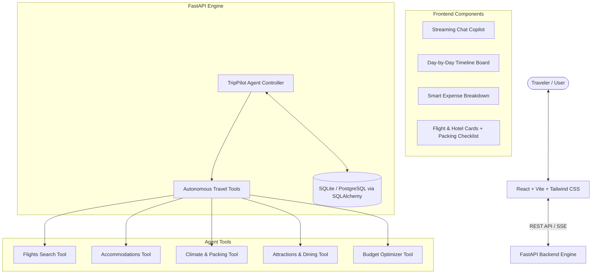

# ✈️ TripPilot Agent - Production AI Travel Planner & Copilot

TripPilot Agent is a full-stack, enterprise-grade AI travel planning assistant and autonomous trip copilot powered by **Google Gemini**, **FastAPI**, and **React (Vite + Tailwind CSS)**.

It generates personalized, realistic, day-by-day travel itineraries, discovers flight options and boutique accommodations, calculates detailed budget forecasts, advises on seasonal weather, and enables real-time conversational itinerary adjustments.

---

## 🌟 Key Features

- 🤖 **Autonomous AI Agent**: Context-aware travel copilot backed by Gemini 2.5 with autonomous tool orchestration.
- 📅 **Day-by-Day Visual Itinerary Board**: Morning, afternoon, and evening activity timelines with local tips, coordinates, and categories.
- ✈️ **Flight & Stay Recommendations**: Live route visualizations, flight schedules, pricing estimates, and hotel tiers (Luxury, Boutique, Mid-Range, Budget).
- 💰 **Comprehensive Budget Breakdown**: Category-by-category expense forecasts (transit, lodging, dining, tickets, emergency buffer).
- ⛅ **Climate & Packing Assistant**: Weather summaries, optimal seasons to visit, and packing checklists.
- 💾 **Session & Trip Persistence**: SQLite / PostgreSQL storage with full CRUD, history, and message memory.
- 📤 **Multi-Format Export**: Export any trip plan to JSON, clean Markdown (for Notion/Obsidian), or print-ready PDF.
- 🐳 **Production Dockerized**: Multi-stage Nginx frontend build and slim Python backend orchestrated via Docker Compose.

---

## 🏗️ Architecture



---

## 🚀 Quick Start (Local Development)

### Prerequisites
- **Python 3.11+** (Python 3.13 tested)
- **Node.js 18+** & **npm**
- **Google Gemini API Key** (optional, high-fidelity synthetic engine active if key is unset)

### 1. Clone & Setup Backend
```bash
cd backend
python -m venv venv

# On Windows:
.\venv\Scripts\activate
# On Linux/macOS:
source venv/bin/activate

pip install -r requirements.txt
cp .env.example .env
```

Add your `GEMINI_API_KEY` to `backend/.env`.

Run backend tests:
```bash
python -m pytest -v
```

Start the backend:
```bash
uvicorn app.main:app --reload --port 8000
```
Interactive API documentation will be available at [http://localhost:8000/docs](http://localhost:8000/docs).

### 2. Setup Frontend
```bash
cd ../frontend
npm install
npm run dev
```
Open [http://localhost:5173](http://localhost:5173) in your browser.

---

## 🐳 Production Deployment (Docker Compose)

Deploy the entire production stack with a single command:

```bash
docker compose up -d --build
```

- **Frontend Application**: [http://localhost:80](http://localhost:80)
- **Backend API**: [http://localhost:8000/api](http://localhost:8000/api)
- **Interactive OpenAPI Docs**: [http://localhost:8000/docs](http://localhost:8000/docs)
- **Health Check**: [http://localhost:8000/api/health](http://localhost:8000/api/health)

To view logs:
```bash
docker compose logs -f
```

To stop:
```bash
docker compose down
```

---

## 🔌 API Reference

| Method | Endpoint | Description |
|---|---|---|
| `GET` | `/api/health` | Service status, uptime, and AI engine readiness |
| `POST` | `/api/chat` | Conversational travel copilot endpoint with session memory |
| `GET` | `/api/chat/sessions` | List active planning sessions |
| `GET` | `/api/chat/sessions/{id}/messages` | Retrieve conversation history for a session |
| `GET` | `/api/trips` | List all saved itineraries |
| `POST` | `/api/trips` | Save an itinerary |
| `GET` | `/api/trips/{id}` | Fetch full trip details |
| `DELETE` | `/api/trips/{id}` | Delete a saved trip |
| `POST` | `/api/trips/generate` | Direct structured trip plan synthesis |

---

## 🛡️ License
MIT License. Built for production-ready autonomous travel planning.
